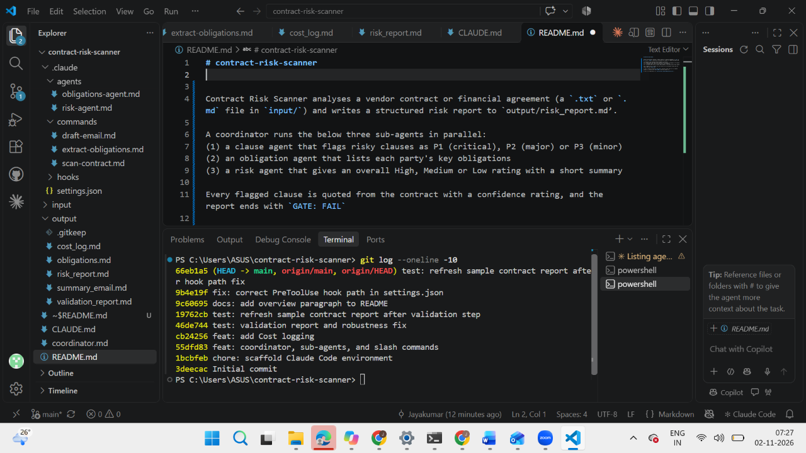

# contract-risk-scanner

Contract Risk Scanner analyses a vendor contract or financial agreement (a `.txt` or `.md` file in `input/`) and writes a structured risk report to `output/risk_report.md`.

A coordinator runs the below three sub-agents in parallel: 
(1)	a clause agent that flags risky clauses as P1 (critical), P2 (major) or P3 (minor)
(2)	an obligation agent that lists each party's key obligations
(3)	a risk agent that gives an overall High, Medium or Low rating with a short summary

Every flagged clause is quoted from the contract with a confidence rating, and the report ends with `GATE: FAIL` if any P1 clause is found and `GATE: PASS` otherwise. Input that isn't a readable contract is rejected with `GATE: ERROR` before any agents run. 

To try it in Claude Code, run `/scan-contract input/sample_contract.txt`.

